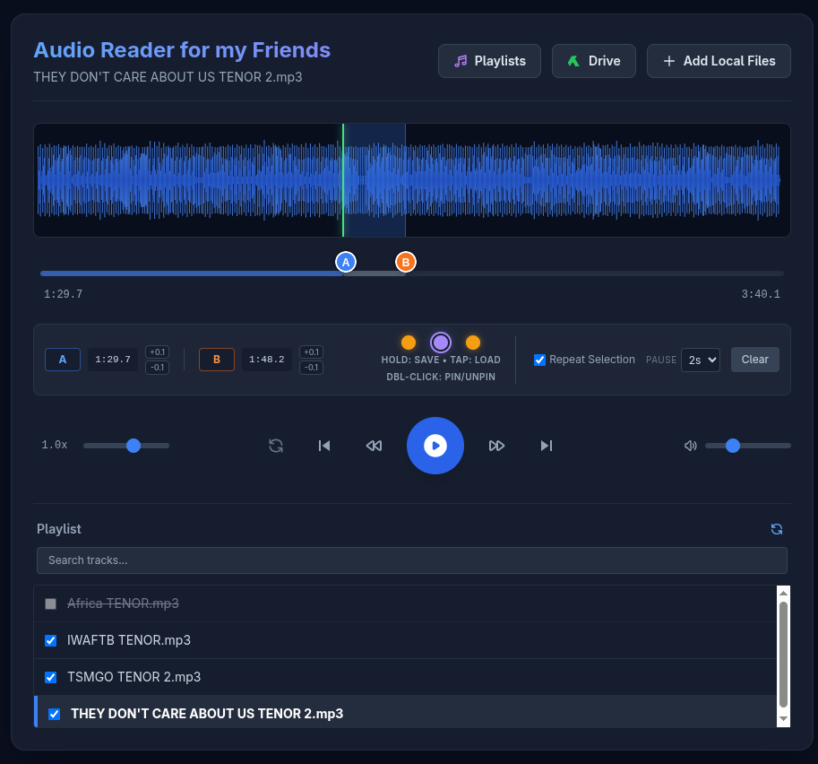

>> Google hasn’t verified this app
>> 
>> The app is requesting access to sensitive info in your Google Account.

# Step 1

Reveal Advanced Options:Bypass warning.On the "Google hasn't verified this app" warning screen, locate and click the Advanced link in the bottom-left corner.Verification: Additional text and a new link will expand at the bottom of the window.

<!--  -->

# Step 2

Proceed to Project:Unsafe link.Click the link that says Go to [Project Name] (unsafe). If you haven't named your Apps Script project, it will say Go to Untitled project (unsafe).Verification: A new screen appears detailing the specific Google Account permissions the script needs.

<!--  -->

# Step 3 

Grant Permissions:Allow access.Scroll to the bottom of the permissions list (which will mention managing your Google Drive files) and click the Allow button.Verification: The authorization window closes and your script is now allowed to run.

<!--  -->
