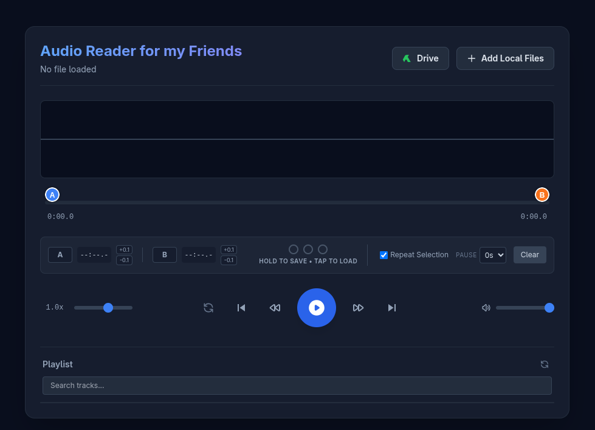

# Audio Reader for my Friends

Audio Reader for my Friends is a lightweight, web-based audio player designed for seamless playback, looping, and memory bank management of your local and Google Drive audio files. 

## Features
- **Local & Cloud Playback:** Load audio files directly from your computer or browse and download them from your Google Drive.
- **A-B Looping:** Select specific segments of an audio file to loop continuously with customizable pause intervals.
- **Memory Banks:** Save and recall up to three specific A-B loop selections per track (automatically saved to your browser's local storage).
- **Speed & Volume Controls:** Adjust playback speed (0.25x to 1.5x) and volume on the fly without altering the pitch.
- **Interactive Waveform:** Visual representation of the audio with click-and-drag selection for easy navigation.

## How to Deploy to Google Apps Script

To enable the Google Drive integration, this app must be deployed via Google Apps Script. 

1. Go to script.google.com and create a New Project[cite: 2].
2. Replace the contents of the default `Code.gs` file with the code provided above[cite: 2]. *(Note: Ensure your Google Apps Script backend code is pasted here).*
3. Click the + next to Files on the left, select HTML, and name it exactly `advanced_mp3_player`[cite: 2]. Paste the HTML code above into this file[cite: 2].
4. Click the Deploy button at the top right, select New deployment[cite: 2].
5. Click the gear icon next to "Select type" and choose Web app[cite: 2].
    - Execute as: "Me"[cite: 2]
    - Who has access: "Only myself" (or "Anyone with Google account" if you want to share the link)[cite: 2].
6. Click Deploy[cite: 2]. Authorize the permissions (it needs access to read your Google Drive)[cite: 2].
7. Open the Web App URL![cite: 2]

## Credits
- **Designed by:** Thierry MARTIN
- **Implemented by:** Gemini

## License
Released under the [MIT License](LICENSE).