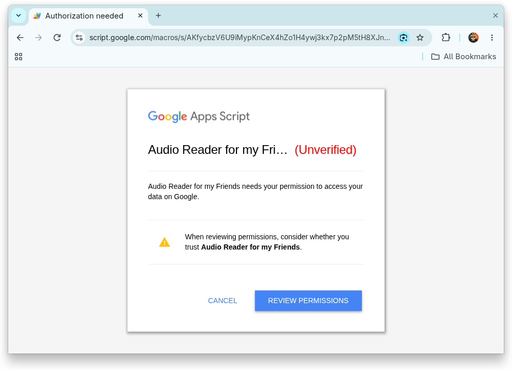
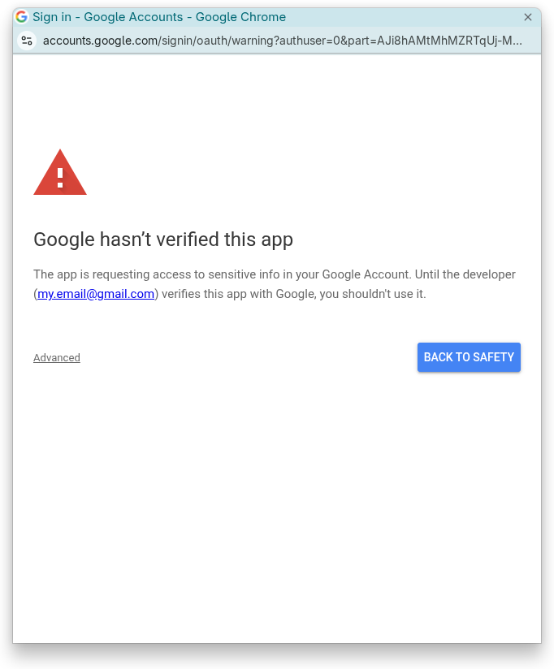
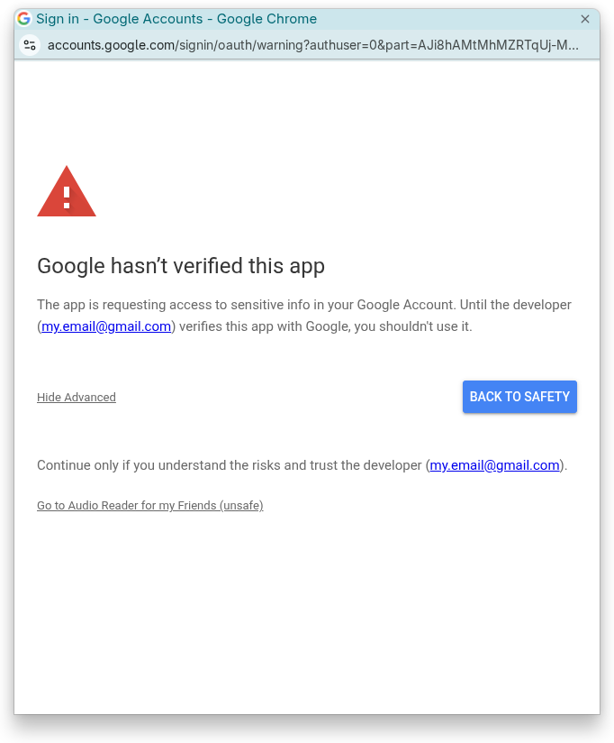
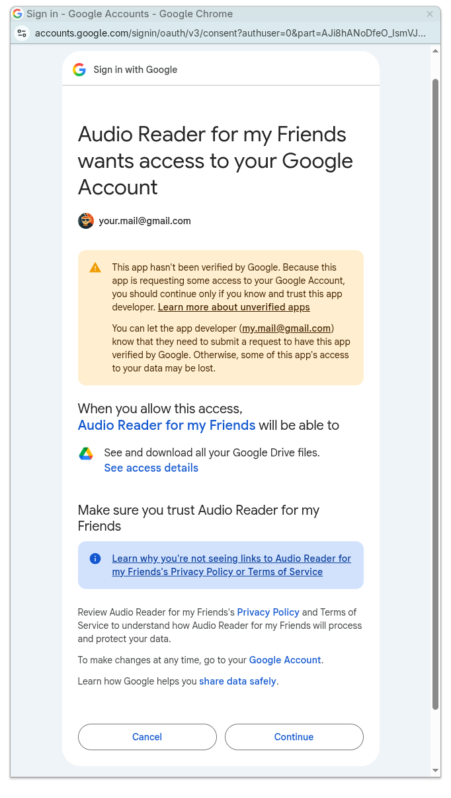

# Autoriser l'application Google Apps Script

> **Google n'a pas validé cette application**
>
> Cette application demande l'accès à des informations sensibles de votre compte Google.

# Étape 1 – Afficher les options avancées

Sur l'écran d'avertissement « Google n'a pas validé cette application », repérez le lien **Advanced (Paramètres avancés)** situé dans le coin inférieur gauche de la fenêtre, puis cliquez dessus.

**Vérification :** Des informations supplémentaires ainsi qu'un nouveau lien apparaissent en bas de la fenêtre.

# Étape 2 – Accéder au projet

Cliquez sur le lien **Go to [Project Name] (unsafe)** (Accéder à [Nom du projet] – non sécurisé).

Si le projet Apps Script n'a pas encore été nommé, le lien affichera :

**Go to Untitled project (unsafe)**.

**Vérification :** Un nouvel écran apparaît, détaillant les autorisations dont le script a besoin pour accéder à votre compte Google.

# Étape 3 – Accorder les autorisations

Faites défiler la liste des autorisations jusqu'en bas (elle mentionne notamment la gestion des fichiers de votre Google Drive), puis cliquez sur le bouton **Allow (Autoriser)**.

**Vérification :** La fenêtre d'autorisation se ferme. Votre compte Google autorise désormais l'exécution du script.
